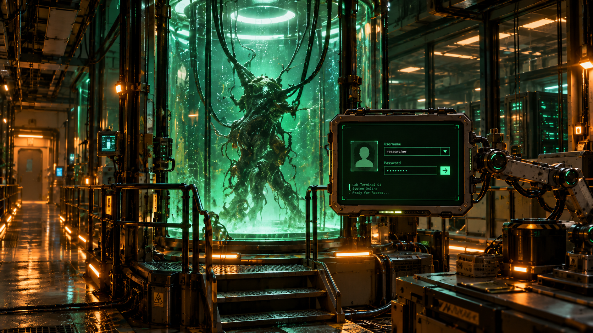

# Cyber Lab SDDM

Ein modulares Qt6/QML-Anmeldetheme für SDDM mit permanent sichtbarem Laborhintergrund und einer grünen Anmeldeoberfläche auf schwarzem Grund.

**Status: erste PNG-Integration auf Grundlage der bestehenden Drei-Gelenk-Animation.** Die Bauteilgrafiken unter `Assets/arm/` und der Monitorrahmen unter `Assets/terminal/` werden nun direkt in QML angezeigt. LED-Ringsegmente können während der Gelenkbewegung umlaufen. Die bestehenden Gelenkachsen und die aus dem Vorschaubild vermessene Endpose bleiben unverändert; der Ablauf dauert weiterhin 2.000 ms mit 50 ms Überlappung zwischen den Gelenkphasen. **Die mechanischen Übergänge, die Größenwirkung und die Perspektive der Einzelgrafiken müssen noch am echten Greeter visuell geprüft werden.** Die SDDM-Schnittstellen sind angebunden; eine echte Systemanmeldung wurde noch nicht geprüft.

## Funktionen

- Benutzerwahl aus `userModel`, vorbelegt mit dem letzten Benutzer, andernfalls dem ersten verfügbaren Eintrag.
- Benutzerbild aus der von SDDM gelieferten `icon`-Rolle; bei fehlendem oder nicht ladbarem Bild erscheint der Anfangsbuchstabe des Benutzernamens.
- Verdecktes Passwortfeld, unmittelbarer Tastaturfokus, Anmeldung mit Enter oder Schaltfläche.
- Übergabe von Benutzer, Passwort und Sitzungsindex an `sddm.login()`. Während eines Versuchs sind weitere Anmeldeversuche und Systemaktionen gesperrt.
- Nach `loginFailed` klare Fehlermeldung, leeres Passwortfeld und erneuter Passwortfokus. Passwörter werden weder gespeichert noch protokolliert.
- Desktop-Sitzungen aus `sessionModel`, vorbelegt mit der letzten gültigen Sitzung.
- Neustart und Herunterfahren über SDDM; Schaltflächen berücksichtigen `canReboot` und `canPowerOff`.
- Tab/Shift+Tab, Pfeiltasten für Auswahllisten und automatisch nachgeführter Scrollbereich bei kleinen Bildschirmhöhen.
- Keine virtuelle Bildschirmtastatur.

Der freigegebene Hintergrund `Assets/backgrounds/final_lab_background.png` bleibt unverändert und dauerhaft sichtbar. Er wird proportional bildfüllend dargestellt; je nach Seitenverhältnis werden die Ränder beschnitten. Auf schmalen Bildschirmen verdeckt der Monitor einen größeren Teil des Tanks. Die Monitorgröße folgt exakt dem Referenzbild. Empfohlen sind 1672×941 oder größer; bei 640×480 und 800×600 sind die Bedienelemente entsprechend klein. Eine automatische Vergrößerung würde die vorgegebene Endpose verändern.

## Aufbau

```text
Main.qml                         SDDM-Kontext, Konfiguration und Anordnung
metadata.desktop                 SDDM-Metadaten, Qt6, Version und Vorschau
theme.conf                       Theme-Einstellungen
Components/
  BackgroundScene.qml            Permanenter Laborhintergrund
  TerminalMonitor.qml            Rechteckiger Monitor mit eigenem Inhaltsbereich
  LoginPanel.qml                 Anmeldung, Fehlerzustand und Fokus
  UserProfile.qml                Profilbild und Ersatzanzeige
  SessionSelector.qml            Auswahl der SDDM-Sitzung
  SystemActions.qml              Neustart und Herunterfahren
  TerminalAnimation.qml          Zeitverlauf der drei Gelenkwinkel und Monitorperspektive
  SwingArm.qml                   Hierarchische Drei-Gelenk-Kette
  ArmLink.qml, ArmJoint.qml       Einfache QML-Platzhalter
  ReferencePose.js               Normierte Messwerte und abgeleitete Endpose
  GreenButton.qml                Gemeinsame Schaltflächengestaltung
  GreenComboBox.qml              Gemeinsame Auswahlgestaltung
Assets/
  backgrounds/final_lab_background.png
  previews/final_terminal_preview.png
  arm/, terminal/, icons/        Reserviert für spätere Entwicklung
scripts/
  test.sh                        Echter SDDM-Greeter im Testmodus
  check.sh                       Statische Prüfung, Qt-Tests, Greeter-Ladetest
  install.sh                     Ausschließlich Kopieren des Themes
tests/tst_theme.qml             Automatisierte Tests mit simuliertem SDDM
```

Die Endpose wird in `Components/ReferencePose.js` aus den vermessenen Bildkoordinaten berechnet: **x=930, y=320, Breite=404, Höhe=292** bei 1672×941. Normiert: **(0,556220; 0,340064; 0,241627; 0,310308)**, frontal mit 0° Roll/Yaw/Pitch. Hintergrund und Gelenkkette verwenden denselben Maßstab und denselben mittigen Bildbeschnitt. Die Animation verändert ausschließlich die vorgeschalteten Gelenkprojektionen; in der Endpose sind diese neutral.

Die [Messdokumentation](docs/reference-pose.md) enthält Bezugspunkte, Messunsicherheiten, Formeln und ein [Overlay](docs/reference-pose.svg). Der angeschnittene Basis-Drehpunkt ist nur näherungsweise rekonstruierbar; die Monitor-Endpose ist davon unabhängig festgelegt.

`TerminalMonitor` nimmt beliebige QML-Inhalte auf. `LoginPanel` erhält Backend und Modelle als Eigenschaften und hängt nicht von der Armbewegung ab. Seine kompakte Oberfläche passt in die ebenfalls vermessene Displayöffnung. Die drei verschachtelten Gelenke übertragen ihre jeweilige Projektion auf alle nachfolgenden Teile. `TerminalAnimation` liefert Winkel und Fortschritt sowie `running` und `ready`; das Monitoraufklappen wird zusätzlich perspektivisch dargestellt. Ein-/Ausschalten, Dauer 0 und Größenänderungen führen zur gleichen Zielpose.

Die Standardbewegung dauert **2000 ms**. Jede Phase verwendet lokal **InOutCubic** mit weichem Anfahren und Abbremsen:

| Zeit | Bewegung |
| --- | --- |
| 0–620 ms | Gelenk 1 schwenkt im Uhrzeigersinn von rechts unten herein, projiziert in der x-y-Ebene. |
| 620–1100 ms | Gelenk 2 hebt den noch flachen Monitor von unten nach oben. Die y-z-Projektion hält die horizontale Handgelenkposition fest. |
| 1100–1340 ms | Gelenk 3 dreht gegen den Uhrzeigersinn in der x-z-Darstellung; die flache Monitorfläche richtet sich frontal auf. |
| 1340–2000 ms | Eine einmalige Nachbewegung von höchstens 0,6°, bis 1800 ms abgeklungen; anschließend ruhige Endstellung. |

Die Bewegungen überlappen nicht. Eine andere konfigurierte Gesamtdauer skaliert alle Phasen proportional. Die Darstellung nutzt einfache QML-Formen; die SDDM-Eingabekomponenten bleiben dieselben. [Gerenderte 2-Sekunden-Vorschau](docs/animation-preview.mp4).

Die gelieferten Kandidatengrafiken und Konzepttafeln liegen unverändert unter `docs/image-package/`. Sie werden weder geladen noch installiert; es wurden keine neuen endgültigen Grafiken erzeugt.

## Voraussetzungen

Geprüfte lokale Umgebung am 18.10.2026:

- EndeavourOS, SDDM **0.21.0-7**, ausführbares Programm `sddm-greeter-qt6`.
- Qt Base **6.12.0-3**, Qt Declarative **6.12.0-1**.
- QML-Module: **QtQuick**, **QtQuick.Controls.Basic**, **QtQuick.Layouts** und deren Qt-Abhängigkeiten.
- Für die automatisierten Tests zusätzlich **QtTest**, `qmltestrunner` und `qmllint` aus der Qt6-Installation; Bash und `timeout` für die Skripte.

Auf diesem System kommen die benötigten QML-Module aus `qt6-declarative`. Andere Distributionen können sie auf mehrere Pakete aufteilen. Das Theme nutzt weder KDE-spezifische Komponenten noch Qt5Compat, QtMultimedia, QtQuick.VirtualKeyboard oder die älteren SddmComponents. Nur PNG-Dateien werden benötigt; Qt SVG ist keine Theme-Abhängigkeit. Ältere Qt6-Versionen sind nicht geprüft; der verwendete gebundene QML-Komponentenkontext setzt Qt 6.4 oder neuer voraus.

Die Schnittstellen wurden mit den installierten Themes und dem [SDDM-0.21-Quelltext](https://github.com/sddm/sddm/tree/v0.21.0/src/greeter) abgeglichen. Weitere Informationen bietet die [offizielle Theming-Dokumentation](https://github.com/sddm/sddm/wiki/Theming).

## Konfiguration

`theme.conf` enthält:

```ini
[General]
AnimationEnabled=true
AnimationDuration=2000
GreenColor=#66ff99
ShowUserPicture=true
```

| Einstellung | Bedeutung |
| --- | --- |
| `AnimationEnabled` | `true`: Drei-Gelenk-Einschwenken; `false`: sofort die vermessene Endpose. |
| `AnimationDuration` | Gesamtdauer in Millisekunden, Vorgabe 2000; `0` zeigt sofort die Endpose. |
| `GreenColor` | Qt-Farbwert für Schrift, Bedienelemente und Rahmen. Für gute Lesbarkeit einen hellen Grünton verwenden. |
| `ShowUserPicture` | `true` zeigt Profilbereich und Ersatzanzeige, `false` blendet den Profilbereich aus. Die Benutzerwahl bleibt verfügbar. |

Für lokale Anpassungen empfiehlt sich `theme.conf.user` mit einer `[General]`-Sektion und den abweichenden Werten. SDDM liest diese Übersteuerungen; das Installationsskript überschreibt diese Datei nicht. Änderungen werden beim nächsten Greeter-Start geladen.

## Testen

Im Repository, ohne Administratorrechte:

```bash
./scripts/test.sh
```

Das Skript startet ausschließlich `sddm-greeter-qt6 --test-mode --theme …`. Es startet keinen SDDM-Dienst und verändert keine Systemkonfiguration. Der Greeter kann die Vorschau bildschirmfüllend öffnen; zum Beenden im aufrufenden Terminal Strg+C verwenden.

Ohne sichtbares Fenster, einschließlich automatisierter Tests:

```bash
./scripts/check.sh
```

Falls die Qt-Werkzeuge anders installiert sind:

```bash
QT6_BIN_DIR=/pfad/zu/qt6/bin ./scripts/check.sh
```

Die Tests verwenden ein simuliertes Backend und ausschließlich erfundene Zugangsdaten. Sie erzeugen Prüfbilder unter `/tmp/cyber-lab-*.png`. Der anschließende Greeter-Ladetest verwendet die tatsächlich installierte SDDM-Version mit dem Offscreen- und Software-Renderer und beendet sie nach fünf Sekunden. Die dabei erwartete Meldung `Socket error: QLocalSocket::connectToServer: Invalid name` entsteht durch den fehlenden Daemon-Socket im Testmodus; sie ist kein QML-Ladefehler. Systemaktionen können in dieser Vorschau deaktiviert sein, und ein Anmeldeversuch kann ohne Daemon-Rückmeldung im Wartezustand bleiben. Die Vorschau dann neu starten.

### Tatsächlich durchgeführt

- `qmllint` für `Main.qml` und alle Komponenten: ohne Warnungen. Die vier von SDDM eingespeisten Kontextvariablen sind gezielt von der statischen Prüfung unqualifizierter Zugriffe ausgenommen und werden im echten Greeter geladen.
- Qt-Tests: **18 bestanden, 0 fehlgeschlagen** einschließlich Initialisierung und Aufräumen.
- Geprüft: Enter und Anmeldeschaltfläche, übergebene Zugangsdaten/Sitzung, Schutz vor doppelter Anmeldung, Fehleranzeige, geleertes Passwort und wiederhergestellter Fokus, Benutzer-/Sitzungswechsel, Profilbild und Ersatzanzeige, Systemaktionsaufrufe und deren Verfügbarkeit, leere Modelle.
- Geprüft: Fokusfolge und automatisches Scrollen bei 640×480; Layout bei **640×480, 800×600, 1280×720, 1672×941 und 1920×1080**; Hintergrund bleibt geladen und sichtbar; Endpose stimmt mit den Referenzkoordinaten überein; Profilbereich lässt sich ausblenden.
- Gerenderte Endpose und Zwischenphasen visuell kontrolliert. Numerisch geprüft: Segmentlänge im räumlichen Liftmodell, Phasenreihenfolge und Drehrichtung, Anheben ohne seitliche Drift des Handgelenks, Eintritt von rechts statt von oben, weiche Phasengrenzen ohne Positionssprünge, kein perspektivisches Übervergrößern, exakte Endpose nach 2000 ms, Ausschalten während der Bewegung, Dauer 0 und Größenänderung während der Bewegung.
- Echter SDDM-Greeter im Testmodus: Theme geladen, kein Rückfall auf das eingebettete Theme, keine QML-Lade-, Bindungs- oder Importfehler.
- Shell-Skripte mit `bash -n` geprüft.

**Eine erfolgreiche Vorschau ist keine geprüfte Systemanmeldung.** PAM-Authentifizierung, Start einer realen Desktop-Sitzung, tatsächliches Herunterfahren/Neustarten, Grafiktreiber im produktiven Greeter sowie Mehrmonitor- und HiDPI-Betrieb wurden nicht getestet. Die aktive SDDM-Konfiguration wurde weder geändert noch das Theme automatisch aktiviert.

## Installation

Erst prüfen, anschließend bei Bedarf ausdrücklich nur die Dateien kopieren:

```bash
./scripts/check.sh
sudo ./scripts/install.sh --copy-only
```

Das Skript installiert QML-Dateien, das Geometriemodul, beide vorhandenen Bilder, Lizenz, Metadaten und `theme.conf` nach `/usr/share/sddm/themes/cyber-lab-sddm/` mit lesbaren Dateirechten. Eine erneute Ausführung aktualisiert diese Dateien. Es bearbeitet keine SDDM-Konfiguration, aktiviert kein Theme und startet keinen Dienst neu. **Die Installation wurde in dieser Entwicklungsrunde nicht ausgeführt.**

Die spätere Aktivierung erfolgt bewusst manuell, beispielsweise über die KDE-Systemeinstellungen für den SDDM-Anmeldebildschirm. Vor einer produktiven Nutzung ist eine gesonderte echte Anmeldung nötig. Dabei muss insbesondere geprüft werden, ob der Systembenutzer `sddm` die gewünschten Benutzerbilder lesen darf.

## Bekannte Einschränkungen und nächste Schritte

- QML-Platzhalter mit Animation; endgültige Arm- und Monitorgrafiken fehlen absichtlich. Die Gelenke verwenden eine projizierte x-y-Drehung, ein y-z-Liftmodell und eine x-z-Aufklappsimulation; aus einem einzelnen Bild ist keine eindeutige 3D-Mechanik ableitbar.
- Standardanmeldung mit Benutzername und Passwort. Zusätzliche PAM-Dialoge wie Passwortwechsel oder mehrstufige Abfragen sind nicht implementiert.
- Es werden die von SDDM angebotenen Benutzer verwendet; keine freie Eingabe versteckter Konten.
- Deutsche Oberflächentexte; keine zusätzliche Sprachauswahl, Tastaturbelegungsauswahl oder Bildschirmtastatur.
- Bei sehr vielen Benutzern wird für jedes Profil ein Bildobjekt angelegt; geladen wird nur das ausgewählte Bild.
- Noch keine Prüfung unter einem produktiven SDDM-Daemon und keine Freigabe als vollständig systemgetestetes Release.

## Gestalterisches Zielbild

Das folgende freigegebene Vorschaubild zeigt die **spätere grafische Gestaltung mit mechanischem Arm**. Die Einzelgrafiken sind noch nicht produktionsfertig. Die Metadaten verwenden dieses vorhandene Vorschaubild. Der aktuelle Monitor besteht ausschließlich aus einfachen QML-Rechtecken.




## PNG-Integration (aktueller Entwicklungsstand)

Die erste visuelle Integration lädt direkt folgende hochgeladene Bauteile:

- `Assets/arm/base.png`, `base_joint.png`, `lower_link.png`, `elbow_joint.png`, `upper_link.png`, `monitor_mount.png`
- `Assets/terminal/monitor_frame.png` als Rahmen mit transparenter Bildschirmöffnung
- `Assets/leds/ring_segment_overlay.png` zur Animation der Gelenklicht-Segmente

Die Quell-PNGs werden **nicht verändert**. Vorhandene Anschlüsse und Proportionen werden zunächst auf die vermessene Referenzgeometrie abgebildet. Die aus Einzelbildern abgeleiteten Monitorwinkel unter `Assets/terminal/poses/` sind noch nicht aktiv, weil ein direktes Umschalten zwischen ihnen ohne Abgleich der Drehachsen zu sichtbaren Sprüngen führen kann. Die bisherige QML-Transformation bleibt für die dritte Gelenkphase aktiv.

**Prüfung nach Pull:** `./scripts/check.sh` und `./scripts/test.sh` starten, besonders auf Gelenkversatz, Bildüberlagerungen sowie die Lesbarkeit und Bedienbarkeit der Anmeldemaske achten. Der Quellcode wurde aktualisiert; ein lokaler Qt-/SDDM-Lauf auf dem Zielsystem ist damit nicht ersetzt.


## Aktuelle Überarbeitung: Klappmonitor, Kompaktlayout und Kabel

- Das Monitorgelenk blendet während der dritten Phase zwischen den unter `Assets/terminal/poses/` vorhandenen Ansichten über. Der komplette Monitor und die Eingabefelder werden nicht mehr künstlich von klein nach groß skaliert. Die verwendeten Bilder sind perspektivisch aus der Frontansicht abgeleitet: Eine physikalisch echte Unterseitenansicht ist damit **noch nicht** nachgewiesen.
- Die Anmeldeoberfläche nutzt kleinere Abstände und ein kompakteres Profilbild; Neustart und Herunterfahren sitzen als Symbolbuttons rechts unten. Die gemessene äußere Monitor-Endpose bleibt gleich.
- Der Unterarm verwendet eine Kabelgrafik; am Oberarm folgt eine gezeichnete Kabelschlaufe der Gelenkprojektion. Das mittlere Gelenk und die Monitorhalterung verwenden unterschiedliche Grafiken.
- Gesamtdauer und 50-ms-Phasenüberlappung unverändert: **2000 ms**.
- Änderungen wurden im Repository gespeichert, sind jedoch noch **nicht auf dem Zielgerät visuell getestet**. Vor produktiver Aktivierung `./scripts/check.sh` und `./scripts/test.sh` ausführen; Kabelanschlüsse, Bildperspektiven und Tastaturbedienung prüfen.
