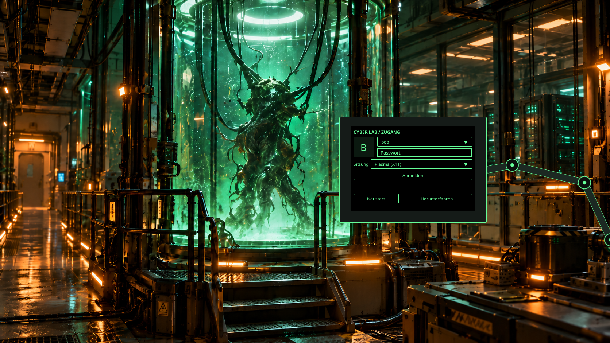

# Vermessene Monitor-Endpose

## Bezugssystem und Messmethode

Verbindliche Bildreferenzen sind `Assets/previews/final_terminal_preview.png` und
`Assets/backgrounds/final_lab_background.png`, beide **1672 × 941 Pixel**. Die Kopien
im gelieferten `cyber-lab-image-package.zip` wurden byteweise damit verglichen: identisch.
Koordinaten beginnen links oben; x zeigt nach rechts, y nach unten.

Der Rahmen wurde im Originalbild an den äußeren Gehäusekanten abgelesen. Der obere
Tragegriff und die seitliche Halterung zählen nicht zum rechteckigen Monitorgehäuse.
Die schwarze Displayöffnung wurde separat vermessen. Der Platzhalter bildet die
rechteckige Hülle des abgefasten Rahmens ab, nicht seine endgültige Silhouette.

Die gemeinsame Bildausrichtung wurde zusätzlich anhand von fünf unverdeckten
40×40-Pixel-Ausschnitten geprüft: normierte Grauwert-Kreuzkorrelation mit einem
Suchbereich von ±8 Pixeln, ohne Skalierung. Beste Verschiebung von Hintergrund zu
Vorschau:

| Ausschnittzentrum | dx, dy | Korrelation |
| --- | --- | --- |
| (100, 800) | (0, 0) | 0,893 |
| (380, 550) | (0, 0) | 0,966 |
| (720, 760) | (−2, 0) | 0,771 |
| (700, 80) | (0, 0) | 0,983 |
| (1130, 180) | (0, 0) | 0,991 |

Vier Ausschnitte stimmen ohne Verschiebung überein. Deshalb wird das gemeinsame
Bildkoordinatensystem verwendet, ohne zusätzliche globale Verschiebung oder
Verzerrung. Die Bilder sind in Details unterschiedlich; sie sind keine zwei
identischen Renderdurchläufe mit bloß zugeschaltetem Monitor.

## Verbindliche Zielwerte

| Größe | Referenzpixel | Normiert auf das vollständige Bild |
| --- | --- | --- |
| Monitor links | 930 | 0,5562200957 |
| Monitor oben | 320 | 0,3400637620 |
| Monitorbreite | 404 | 0,2416267943 |
| Monitorhöhe | 292 | 0,3103081828 |
| Monitorzentrum | (1132, 466) | (0,6770334928; 0,4952178533) |
| Display links/oben | (962, 346) | (0,5753588517; 0,3676939426) |
| Displaybreite/-höhe | (340, 234) | (0,2033492823; 0,2486716259) |
| Endausrichtung | frontal, Roll=0°, Yaw=0°, Pitch=0° | keine Scherung oder Perspektivverzerrung |

Die normierten Werte stehen zentral in `Components/ReferencePose.js`. Die
Bruchschreibweise erhält die vermessenen Pixelwerte ohne Dezimalrundung. Breite,
Höhe und Lage werden nicht mehr anhand der Fenstergröße frei gewählt.

Das Ablesen der gezeichneten Gehäusekanten hat eine Unsicherheit von ungefähr
**2–3 Referenzpixeln**. Die vielen Dezimalstellen dienen der reproduzierbaren
Umrechnung, nicht der Behauptung einer subpixelgenauen Bildmessung. Als festgelegte
Endpose gelten exakt die oben angegebenen Werte. Der Gehäuserahmen und die
Displaykanten sind im Bild annähernd achsenparallel; die Bedienfläche wird gemäß
der frontalen Referenz auf 0° ausgerichtet.

## Abbildung auf den Bildschirm

Für eine Fenstergröße `(W, H)` gilt derselbe mittige Bildbeschnitt wie für den
Hintergrund mit `Image.PreserveAspectCrop`:

```text
s  = max(W / 1672, H / 941)
dx = (W - 1672*s) / 2
dy = (H - 941*s) / 2

Monitor links = dx + 930*s
Monitor oben  = dy + 320*s
Breite        = 404*s
Höhe          = 292*s
```

Bei 1280×720 ergibt das ungefähr `(711,96; 244,78)` mit `309,28×223,54` Pixeln.
Bei 4:3 wird seitlich beschnitten. Es gibt absichtlich keine zusätzliche
Fensterzentrierung, Mindestgröße oder Randkorrektur, die den Monitor relativ zum
Tank verschieben würde. Auch eine Größenänderung während der Animation verwendet
sofort dieselbe neue Abbildung für Hintergrund und Arm.

## Drei Gelenke und Endstellung

Die Gelenkpunkte wurden aus den sichtbaren Ringzentren der Vorschau abgeleitet:

| Gelenk | Referenzpunkt | Einordnung |
| --- | --- | --- |
| Basis/Schulter | (1674, 658) | Ring angeschnitten; Mittelpunkt näherungsweise aus sichtbarem Kreisbogen rekonstruiert, etwa ±8 px |
| Ellbogen | (1602, 501) | sichtbares Ringzentrum, etwa ±3 px |
| Handgelenk/Monitorhalter | (1404, 453) | sichtbares Ringzentrum, etwa ±3 px |

Die Bildreferenz bestimmt keine eindeutige räumliche Robotermekanik. Implementiert
ist eine **planare Drei-Gelenk-Kette mit zusätzlicher perspektivischer Darstellung
des Monitoraufklappens**, keine behauptete exakte 3D-Rekonstruktion.

Aus den Punkten folgen die konstanten Segmentlängen:

```text
L1 = hypot(1602−1674, 501−658)
L2 = hypot(1404−1602, 453−501)
q1 = atan2(501−658, 1602−1674)              ≈ −114,636130°
q2 = atan2(453−501, 1404−1602) − q1       ≈  −51,736875°
q3 = 0° − q1 − q2                       ≈  166,373005°
Monitor links/oben relativ zum Handgelenk = (930−1404, 320−453) = (−474, −133)
```

Die dritte Rotation richtet das Monitorgehäuse frontal aus. Der feste
Halterungsversatz verbindet das Handgelenk mit der rechten Gehäuseseite. Eine
Änderung der Basis-Rekonstruktion ändert die berechneten Winkel/Längen, nicht die
festgelegten globalen Monitor-Zielkoordinaten.

`SwingArm.qml` bildet die verschachtelte Kette Schulter → Ellbogen → Handgelenk
ab. Alle nachfolgenden Elemente erben die vorherigen Drehungen. Die Animation
verändert **Gelenkwinkel**, nicht unabhängig geschätzte Monitor-x/y-Werte.

Die Bewegung ist eine gestaltete Hinführung: bei 0 %, 55 %, 83,75 % und 100 %
liegen Winkel-Offsets relativ zur berechneten Endpose. Jeder Track endet exakt
bei **0**. Die perspektivische Monitorrotation endet ebenfalls bei **0°**. Es
werden weder versteckte Bildinhalte rekonstruiert noch Kandidatengrafiken verwendet.
Bei 800 ms liegen die Phasengrenzen bei 440, 670 und 800 ms. Eine kleine
Gegenbewegung der Gelenke vor dem Ende vermittelt das Einrasten, ohne die Endpose
zu verändern. Bei deaktivierter Animation oder Dauer 0 wird sofort dieselbe
Endpose angezeigt.

## Nachweis und Bildpaket

Die Qt-Tests prüfen die vier Monitor-Ecken gegen unabhängig festgeschriebene
Bildmesswerte, einschließlich Bildbeschnitt, mit einer numerischen Toleranz von
0,01 Bildschirmpixeln. Diese Rechengenauigkeit ist von der oben beschriebenen
Messunsicherheit zu unterscheiden. Außerdem werden konstante Segmentlängen,
alle drei bewegten Gelenke, Ende/Abbruch/Dauer 0, Fokus und Größenänderung während
der Bewegung geprüft. Fünf gerenderte Phasen liegen nach dem Test unter
`/tmp/cyber-lab-motion-0.png` bis `-4.png`.

[Messoverlay auf dem freigegebenen Vorschaubild](reference-pose.svg)

Aktuelle QML-Endpose, mit erfundenen Testbenutzern:



Die gelieferten Kandidaten und Konzepttafeln liegen unverändert unter
`docs/image-package/`. Das dortige Originalmanifest beschreibt Referenzmaterial;
seine Aussagen sind keine Produktionsfreigabe. Auf ausdrücklichen Wunsch werden
vorerst nur QML-Formen verwendet. Die Referenzdateien sind kein Bestandteil der
Theme-Installation. Der bestehende Laborhintergrund bleibt unverändert.
